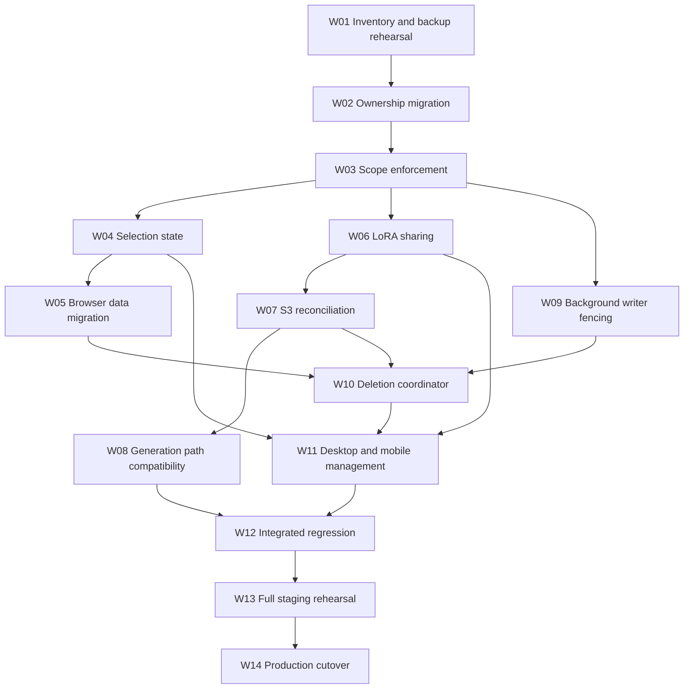

# Workspace isolation: detailed implementation plan

Status: planning only; do not execute until the user explicitly authorizes implementation.
Date: 2026-10-12
Source of truth: [Workspace isolation specification](workspace-isolation-spec.md)
Surfaces: desktop and mobile

## 1. Delivery boundaries

This plan turns the agreed scope into ordered, reviewable work packages. It does not authorize schema changes, production mutations, service restarts, new S3 objects, or generation runs.

When implementation is authorized:

- Create local backlog tickets under `backlog/tasks/` for W01-W14, with dependencies and the acceptance criteria below. W identifiers here are planning identifiers, not already-created tickets.
- Run repository-affecting commands as Unix user `engui`, but commit/push with Artem's git/GitHub identity.
- Keep implementation commits bounded by work package. Do not include unrelated files or the existing untracked `tmp/`.
- Use English documentation, comments, tests and UI copy.
- Do not run paid RunPod jobs or Studio Session generations without separate approval.
- Run long migrations, manifests, builds and rehearsals detached, with persistent log, PID/run identity, exit code and observable status.

Current document delivery requires Markdown/link/scope checks, not a production build/restart. The later implementation release requires the production build, explicit service restart and verification described in W14.

## 2. Architecture decisions and dependency order

1. Server-side ownership is authoritative; client selection is not an authorization mechanism.
2. The original Default identity is immutable and independently protected.
3. Global configuration is separate from workspace content. Library-specific settings/presets remain content.
4. Jobs/uploads/background actions capture workspace and source identities at initiation.
5. Shared LoRAs remain single Default-owned records/objects.
6. Server migrations and browser migrations are separate, both idempotent and preservation-first.
7. Workspace deletion is a durable saga with write fencing and external cleanup, not a cascade endpoint.
8. S3 pruning requires positive evidence of absence, not absence of evidence.

Dependency outline:

W09 can proceed alongside W04-W08 after scope contracts stabilize. W11 can build non-destructive UI earlier, but delete controls stay inaccessible until W10 passes. Do not release partial namespaced uploads before W08 proves endpoint compatibility.

## 3. Verified code map and known traps

| Area | Existing touchpoints | Work needed |
| --- | --- | --- |
| Schema | `prisma/schema.prisma` | Missing roots, immutable Default protection, deletion state, reference integrity |
| Selection | `src/lib/context/StudioContext.tsx` | Restore saved selection; validate; remove implicit resets; fence stale requests |
| Independent selection | `src/components/video-sequences/VideoSequenceBuilder.tsx` | Remove competing localStorage/default initialization |
| Desktop | `src/components/layout/RightPanel.tsx` | Management and isolation-aware rendering |
| Mobile | `src/components/mobile/create/MobileAdvancedScreen.tsx`, `src/app/m/` | Workspace controls in Advanced Settings and scoped screens |
| Drafts | `src/lib/create/createDraftSchema.ts`, `createDraftStore.ts`, `createDraftMigrations.ts` | Scoped envelope and Default-only legacy import |
| Browser media | `src/lib/create/createMediaStore.ts` | Ownership/reference tracking and all-drafts GC |
| Reuse/presets | `persistCreateReuseDraft.ts`, `persistImageReuseDraft.ts`, `videoPresets.ts`, `loraDraftSanitizer.ts` under `src/lib/create/` | Preserve origin workspace and avoid importing into active workspace |
| Workspace API | `src/app/api/workspaces/` | Safe initialization/update/delete; disable legacy job transfer/unassignment |
| Preset API | `src/app/api/create/video-presets/route.ts` | Replace overloaded userId ownership; reject cross-owner upserts |
| S3 LoRA routes | `src/app/api/lora/` | Owner prefix, shared library, complete listing and safe pruning |
| Generation | `src/lib/generation/submitFormData.ts` | Validate scope and LoRA access; preserve full relative paths |
| Cleanup | `src/lib/jobManagement.ts`, `src/lib/galleryCleanup.ts` | Reuse low-level operations only behind durable deletion coordination |

Important traps verified during the audit:

- `StudioContext` writes `activeWorkspaceId` but startup does not restore it.
- Workspace DELETE currently reassigns/unassigns jobs and then cascades other content.
- Default updates are not a safe immutable identity mechanism; mutable flags can defeat protection.
- Video presets use `Preset.userId = workspaceId`; upsert by bare preset ID can reassign ownership.
- `cleanupOrphanedCreateMedia(state)` compares all IndexedDB media to one supplied draft, which becomes destructive after introducing workspace-scoped drafts.
- Current S3 root listing uses a directory delimiter; directory entries are not evidence of all nested files.
- Empty CLI output can look like an empty S3 directory.
- Sync matches existing LoRAs globally by path; new ownership rules must not steal another owner's record.
- Image submission can strip LoRA paths to basenames.
- Gallery cleanup can delete a record before unlink and tolerate file errors; this cannot prove full workspace deletion.
- Existing job deletion guards/materialization rules are designed for individual jobs, not a whole-workspace drain.
- The previously documented endpoint checkout location was unavailable during inspection. Locate actual active repositories; do not infer remote compatibility.

Touchpoints are not an exhaustive endpoint inventory. W01/W03 must expand the inventory before implementation is considered complete. Proposed new modules/tables below do not exist yet.

## 4. W01 — Inventory, preservation manifest and backup rehearsal

**Prerequisite:** explicit implementation authorization.

### Tasks

1. Create local backlog tickets linked to this plan and the specification.
2. Record clean/dirty git state, running app version, schema hash, SQLite version, processes and storage configuration fingerprints without copying secrets.
3. Enumerate every Prisma model, route, background writer, seed/import script, browser key and managed file family. Classify each as global, owned root, inherited child, shared reference or operational audit.
4. Capture fresh Default identity and all workspace ownership counts. Assert exactly one valid original Default; never identify it from display name alone.
5. Capture record ID sets, stable content-field hashes, parent-child relations, gallery flags and LoRA metadata. Record originals, thumbnails, character files, audio/exports, browser migration keys and S3 full keys.
6. Keep historical gallery preservation independent of current jobs.
7. Identify all writers and safe quiescence controls: app requests, polling, materializers, renderers, preview producers, uploads and external completion handlers.
8. Choose backup storage based on measured size/capacity. Use SQLite's backup facility or a properly quiesced snapshot that includes WAL state; do not copy an open DB file blindly.
9. Back up referenced local media and required S3 objects or verified recoverable versions. Record what is actually restorable; ETag is not universally an MD5 checksum.
10. Restore onto an isolated staging path and verify schema, record manifests and representative media. Where byte hashes are captured, compare them.
11. Keep staging disconnected from production writers/buckets and real job submission. Use mocks and local fixtures.

### Deliverables and exit gate

- Ownership/route/writer/file inventory, fresh baseline, backup manifest and demonstrated restore.
- No unresolved root/child classification or unaccounted destructive file path.
- Storage backup coverage and limitations documented.
- **Acceptance:** AC01, AC14.

## 5. W02 — Schema ownership and preservation migration

### Proposed schema changes

- `Workspace.isProtected`: persisted, immutable protection for the original Default; initialization and ordinary updates cannot remove it.
- Workspace lifecycle state/revision: active, deleting, deletion_failed; use a separate durable deletion record/tombstone after removing the workspace row.
- Explicit required `workspaceId` on previously unscoped content roots.
- Inherited ownership for child records unless direct querying needs an explicit constrained column.
- LoRA visibility/source identity metadata for W06/W07, initially private and assigned to the verified current target.
- Durable migration ledger and deletion journal that do not disappear through workspace cascade.
- Workspace association for job-related operational records where applicable; global account totals remain global.

Database safeguards should include delete/update protection for original Default and a per-user uniqueness invariant for protected identity. A database trigger protects ordinary SQL operations, not a privileged administrator rewriting the schema.

### Migration mapping

| Existing entity/family | Migration rule |
| --- | --- |
| Workspace | Protect verified existing Default; preserve ID/user/name; prevent canonical-default reassignment |
| Job, GalleryAsset, PromptDocument, PromptWildcard, LoRA, PosePreset, ScenePreset | Preserve valid workspace IDs; classify genuinely unscoped legacy rows to original Default; reject contradictory evidence |
| Character | Add owner; backfill legacy roots to original Default |
| CharacterVersion | Inherit Character; preserve version IDs and currentVersion links |
| VibePreset | Add owner; backfill legacy rows to original Default |
| VideoProject | Add owner; backfill legacy roots to original Default |
| VideoTrack, VideoKeyFrame | Inherit through project; verify parent chains and referenced files |
| Preset | Add workspaceId; derive from legacy userId when it is a valid workspace ID, then restore actual owning userId |
| Preset with actual legacy userId | Assign to that user's verified original Default; reject ambiguous/unknown user or workspace values |
| VideoSequence, VideoSegmentTemplate | Preserve owners; verify linked source assets and templates |
| Studio roots and child families | Preserve explicit owners; verify template/shot/revision/version/run/session/portfolio/pose/category relations agree |
| LoRAHelperProfile | Derive/validate owner through source LoRA; flag orphan profiles |
| JobMaterializationTask, StudioSessionJobMaterialization | Validate against job/session owner, never active UI selection |
| SceneCharacterBinding | Derive scene owner; verify linked character owner |
| Pose preview candidates, framing and pose-library settings | Preserve/derive owner from relevant library/pose |
| CreditActivity, ApiLog, UsageStats | Keep global account/operational records; attach known job workspace without inventing ownership for account-wide rows |

Validate cycles/references such as character current version, Studio selected versions and portfolio covers explicitly. Preserve all 16 observed presets and their options/timestamps; counts are refreshed at execution.

### Migration mechanics

1. Introduce a checked-in, versioned migration runner with dry-run reporting and checksummed ledger entries. Select an existing project-compatible runner after inventory; no blind schema push.
2. Dry-run reads source rows and emits proposed ownership changes, ambiguities and constraints without modifying production.
3. Require the expected original Default ID as verified deployment input, not a globally hardcoded application constant.
4. Start from a consistent backup with writers paused for real application.
5. Add nullable ownership fields first; backfill deterministically in a transaction.
6. Validate ID sets, content hashes, foreign keys and cross-owner links before enforcing NOT NULL/indexes.
7. For SQLite table rebuilds, enumerate every preserved column/index/foreign key/trigger; copy into the new shape transactionally and compare manifests before final replacement.
8. Set immutable protection and constraints without exposing a window where deletion can run unprotected.
9. Record migration completion atomically. On rerun, verify checksum/schema and return no-op; do not silently repeat a partial unknown migration.
10. Regenerate Prisma client and verify queries against a migrated copy.

Legacy columns/values may be retained for a documented recovery period if needed, but they must not remain an alternate active ownership mechanism. No data reset, mass reassignment or file relocation.

### Exit gate

Migration runs twice on a copy: first preserves all historical content and adds ownership; second makes no changes. Injected ambiguous rows fail before committing. **Acceptance:** AC01, AC02, AC07, AC13.

## 6. W03 — Scope services and complete API enforcement

### Tasks

1. Introduce one reusable server resolver for active/owned workspace operations and separate resolvers for explicitly global operations and readable shared LoRAs.
2. Require validated scope at content entry points; background operations resolve from stored owner rather than request-global state.
3. Enforce ID-plus-owner queries for reads/mutations and parent-child membership before writes.
4. Make mixed-scope bulk operations reject atomically rather than partially modifying another workspace.
5. Remove implicit Default fallback from ordinary generation/content requests. Initialization is the only explicit legacy/bootstrap exception.
6. Replace preset upsert-by-ID reassignment with owner-checked create/update.
7. Reject legacy job move/unassign routes with a clear unsupported-operation response.
8. Make seeds/imports idempotent per intended owner. New workspaces may receive bundled starter definitions, never copies of the user's Default library.
9. Audit shared/global settings and raw storage-administration routes. Ordinary workspace UI must not turn global storage access into unscoped content sync/deletion; retain global infrastructure administration only as an explicit global operation.
10. Return consistent English errors for invalid scope, conflict/deleting state and unavailable references.

### Required route coverage

Maintain a checked-in inventory mapping each route to its scope service and test:

- Workspaces, initialization, direct-ID updates and nested job endpoints.
- Gallery list/ID/favorite/tags/reuse/trash/enrichment/from-job-output/backfill and carousel/feed-window.
- Jobs list/ID/cancel/delete/bulk cancel/clear/favorite/reuse and generation/status/upscale paths.
- LoRA list/ID/helper-profile/upload/multipart/sync.
- Characters/versions/preview/assist/extract; vibes; scenes; poses.
- Prompt documents and wildcards.
- Video projects/tracks/keyframes/audio/export.
- Video sequences/segments/templates.
- Studio import/export/copy/reorder/preview/runs/materialization and all descendant routes.
- Voice/audio user libraries and browser-to-server reuse entry points where present.

Do not resurrect deprecated `workspace-media` endpoints that already return 410.

### Exit gate

Synthetic A/B fixtures prove list, direct-ID, linked-child, bulk and output paths obey scope. Shared settings are identical from A and B. **Acceptance:** AC04, AC07, AC13.

## 7. W04 — Persistent selection and client request isolation

### Tasks

1. Define one selection controller used by StudioContext and all desktop/mobile consumers.
2. Boot order: load validated workspaces, read tab choice, then browser last-explicit choice; initialize Default only when no saved choice exists.
3. Distinguish loading, valid selection, unavailable saved selection and no selection. Never reinterpret network failure as first-run initialization.
4. Persist explicit choices to tab/browser storage. Ignore cross-tab selection events as switch commands.
5. Consolidate VideoSequenceBuilder's independent selection/default creation into the shared controller.
6. Make workspace create/rename/delete UI use explicit selection semantics. `Create and switch` is intentional; background creation alone is not.
7. Key caches, requests, polling and selections by workspace. Clear old rendered content on switch, abort stale requests and discard late results.
8. Capture owner at submission/helper/reuse start. Do not write a delayed helper result into the newly selected draft.
9. Ensure global preferences/settings are not duplicated or cleared.

### Exit gate

Test page reload, route navigation, new tab, existing second tab, offline fetch failure, deleted stored ID, rapid A/B switching and delayed A responses. **Acceptance:** AC03, AC12.

## 8. W05 — Browser migration and attachment safety

### Known storage to audit

- `engui.create.state.v2` and legacy v1.
- `engui-create-media` IndexedDB / `draft-media`.
- `engui.create.video.presets.v1`.
- `engui:wan22-video:source-image-prompt-cache:v1`.
- `engui:prompt-constructor:reuse-draft`.
- `engui:prompt-helper:instruction`.
- `engui.mobile.pending-preview`.
- User voice samples/favorites, prompt history and any additional user-content keys found in W01.
- Already-scoped gallery/jobs state: preserve rather than double-migrate.
- `engui_settings` and presentation preferences remain global.

### Tasks

1. Version the scoped draft envelope and keys using workspace ID, not display name.
2. Add an explicit legacy-to-protected-Default migration journal with stages, source checksum/version and completion marker.
3. Migrate without overwriting existing newer scoped Default content. Preserve conflicts in a recoverable local record.
4. Upgrade IndexedDB transactionally with media owner/reference metadata. Preserve blobs and IDs.
5. Gate garbage collection until migration/reference discovery is complete. GC scans references across all scoped and retained legacy drafts.
6. For shared blob references, use reference bookkeeping; one draft/workspace deletion cannot erase another live reference.
7. Update load/save/reset/reuse/sanitizer/import callers to require captured workspace identity.
8. Legacy video presets import to Default exactly once, not whichever workspace is active. Preserve original preset IDs when possible and reconcile server migration.
9. Handle blocked IndexedDB upgrades, another open tab, quota failure, interrupted localStorage writes and retry without duplicates/data loss.
10. Reconcile deleted workspace tombstones before browser import/GC. Clean only that workspace's browser records on contact, including offline devices returning later.
11. Retain recovery material according to a documented policy; do not keep it as a live source that resurrects deletions.

### Exit gate

Fixtures cover two independent drafts with media, legacy-only browser, existing scoped Default, another active workspace, interrupted migration and deleted workspace return. Compare blob bytes/IDs before and after. **Acceptance:** AC02, AC05, AC12.

## 9. W06 — Owned and shared Default LoRAs

### Tasks

1. Introduce explicit visibility on one owned LoRA record, defaulting private.
2. Enforce that only original protected Default can own globally shared LoRAs.
3. List owned items plus eligible shared Default records, deduplicated.
4. Keep mutation/helper-profile guards owner-only; consumer weight edits stay in consumer drafts.
5. Group WAN pairs using owner, canonical source directory and compatible model/pair metadata, not filename suffix alone across the full mixed library.
6. Apply share/unshare to a complete eligible high/low pair atomically. Reject incomplete/inconsistent pairs without silently publishing one half.
7. Expose English sharing controls only in Default; show shared-source badges and read-only source details elsewhere.
8. Increment visibility/library revisions and invalidate appropriate caches.
9. On unshare, retain snapshots/outputs and preserve drafts with explicit unavailable selections.
10. For shared-source deletion, show cross-workspace impact, block new uses and defer physical removal until accepted references are safe. This is distinct from deleting a consumer workspace.
11. Ensure copied snapshots in historical jobs remain interpretable after source deletion.

### Exit gate

One shared source appears in new workspaces without copying; private Default items remain hidden; consumers cannot mutate; pair changes are atomic; deleting consumer A preserves source and B. **Acceptance:** AC08.

## 10. W07 — Namespaced S3 uploads and error-safe sync

### Proposed components

Separate namespace/target resolution, listing/absence evidence and reconciliation from route code. Represent storage identity with a stable target fingerprint plus full key; never store credentials in content records or logs.

### Upload tasks

1. Resolve Default root versus `loras/workspaces/<id>/` from validated owner.
2. Preserve root paths for existing Default files; reject unsupported arbitrary folders.
3. Bind multipart upload ID, owner, target and expected key at initialization in durable state.
4. Validate finalize/abort against that binding; switching tabs/workspaces cannot reassign it.
5. Handle duplicate names explicitly and avoid unintended overwrite.
6. Fence uploads against deleting workspace and concurrent sync using a lease/revision mechanism.
7. Finalization after workspace deletion must abort/clean the captured owned object, not create a new LoRA row.
8. Retain sufficient target identity for cleanup if global connection settings change; fail visibly if the original target is no longer accessible.

### Sync tasks

1. Replace permissive CLI-output interpretation with a dedicated complete-list contract.
2. Validate every page, continuation token, target, prefix and response status. Reject empty stdout/malformed structures.
3. Filter direct LoRA files in the owner directory. Default excludes `workspaces/`; do not recursively import other owners.
4. Match exact source identity plus owner. A conflict with another owner is an error, never a reassignment.
5. Preserve model/type/helper/user metadata for existing objects.
6. Stage candidates and independently probe missing objects. Verify bucket/target before treating object 404/NoSuchKey as absence.
7. Treat 403, network failures, missing bucket, unsupported response and partial page sequence as non-destructive errors.
8. If any absence proof fails, skip the destructive phase; additions already safely established may be reported separately.
9. Recheck database identity/revision and upload coordination immediately before pruning.
10. Delete confirmed-missing owned LoRAs/profiles transactionally; retain historical job metadata and generated assets.
11. Emit structured reconciliation summary with complete/partial/failed state, counts and no secret values.

### Failure-injection gate

Cover successful empty listing, truncated pagination, duplicate/repeated tokens, malformed/empty response, 403, timeout, missing bucket, target change, object 404, one failed HEAD in a batch, concurrent upload/finalize, shared record visibility and sync during deletion. **Acceptance:** AC09.

## 11. W08 — Generation and endpoint path compatibility

This is a release blocker for new-workspace LoRAs.

### Tasks

1. Locate the actual active endpoint repositories/configurations and map each Engui generation adapter to a deployed handler. A stale documented checkout path is not evidence.
2. Trace LoRA selection through `submitFormData.ts`, job serialization, provider payload, secure transport rewriting, worker download/cache and workflow loading.
3. Resolve eligible LoRA IDs on the server to immutable canonical relative keys. Reject another workspace's private ID and arbitrary path strings.
4. Preserve `workspaces/<id>/<file>` beneath the known LoRA root instead of using only `split('/').pop()`.
5. Keep old Default root references valid for historical snapshots/reuse. Limit compatibility work to preserving existing content, not a general legacy-product rewrite.
6. Apply the contract across image models, WAN high/low paths and any other supported LoRA consumer.
7. Verify cache identities cannot collide for identical basenames in A, B and Default.
8. Update endpoint code only if actually required, with local backlog tickets in the corresponding repository and user git identity.
9. Do not enable namespaced upload/sync in production until the entire path is compatible. If endpoint access is blocked, report it; do not ship a half-working UI.

### Exit gate

Contract fixtures prove root Default, A/private, B/private and shared Default files resolve correctly; traversal/foreign IDs fail; WAN pair paths remain distinct. No paid jobs launched. Any needed live validation remains a separately approved gate. **Acceptance:** AC10.

## 12. W09 — Background writers and deletion fencing

### Tasks

1. Enumerate and update all job submit/poll/status/cancel paths, Studio materializers, sequence coordinators, preview/render tasks, async imports and uploads.
2. Persist workspace at job/task creation; validate child task owner against parent.
3. Make every writer check workspace lifecycle and a deletion revision/epoch before publishing results.
4. Bind callbacks to stored job identity, never current browser selection.
5. Prevent new work after deletion lock, including queued local tasks that have not started.
6. Define active/terminal states explicitly, including finalizing/materialization states not covered by existing generic RUNNING arrays.
7. Reconcile terminal/cancel races idempotently. A completion that loses the race to deletion cannot create a gallery entry.
8. Store sufficient references to clean late output; do not discard evidence just because job rows will be removed.
9. Provide pause/drain controls for deployment separately from destructive workspace deletion. Upgrading must not implicitly cancel Default jobs.
10. Ensure worker/service restart resumes journaled tasks and deletion cleanup correctly.

### Exit gate

Delayed callbacks, polling, local finalization and multipart completion across switch/deletion cannot write to the wrong or deleted workspace. **Acceptance:** AC04, AC11, AC12.

## 13. W10 — Durable whole-workspace deletion

### Proposed durable records

A deletion operation stores workspace identity, requested time/user, lifecycle stage, cancellation results, manifest items, attempts and non-secret errors. It survives removal of the workspace row. Use unique operation/resource keys for idempotency.

Store a minimal tombstone after completion to reject stale clients/callbacks; do not retain prompts or other deleted content in the tombstone.

### Coordinator tasks

1. Preflight protected Default and collect a preview of owned counts/references.
2. Require deliberate UI confirmation but enforce protection independently server-side.
3. Acquire a workspace deletion lock, increment epoch and block all new writers.
4. Cancel upstream/local queued/running jobs using stored provider IDs/endpoints. Missing cancellation access is a failure, not success.
5. Observe terminal state and drain finalization/render/materialization before destructive file cleanup.
6. Refresh/finalize the resource manifest after fencing/drain; the preflight snapshot alone is insufficient.
7. Include gallery originals/thumbnails, job outputs, character media, project audio/exports, Studio/sequence artifacts, temporary uploads and owned S3 LoRAs. Classify every reference found by W01.
8. Exclude global resources, shared Default LoRAs, and objects still required by a valid different owner. Report ambiguous ownership for resolution.
9. Use canonical safe paths, exact target/key identity and per-item deletion results. No recursive shared-root cleanup.
10. Abort unfinished owned multipart uploads and sweep late captured artifacts.
11. Delete records in dependency order, clearing cyclic selected/current references safely. Do not invoke current transfer-to-Default behavior.
12. Retain enough state for retries after crash, cancellation timeout, local unlink error, S3 denial or database failure.
13. Only mark complete after owned cleanup and record deletion succeed. Keep failed/deleting workspace locked and visible with progress and `Retry deletion`.
14. Reconcile browser caches/media on connected clients; offline clients do so when returning.
15. If active, require explicit successor selection. Do not switch other tabs silently.

### Exit gate

On isolated copies, delete populated synthetic A while Default and B remain byte/record-identical where applicable. Repeat and interrupt each stage. Verify shared Default source survives, external failure leaves retry state, and direct protected deletion fails before any cleanup. **Acceptance:** AC07, AC11, AC12.

## 14. W11 — Desktop/mobile management and English UX

### Tasks

1. Add shared management actions for create, rename, explicit select and delete.
2. Integrate desktop selector/management in the existing layout; mobile controls in Advanced Settings.
3. Display protected Default state, selected workspace and deletion progress clearly.
4. Use explicit `Create`, `Create and switch`, `Delete workspace`, `Retry deletion` and `Choose workspace` semantics.
5. Warn that deleting a workspace removes its owned jobs/files/S3 LoRAs. Show counts from preflight and refresh at confirmation if changed.
6. Do not expose delete for Default; still handle server rejections correctly.
7. Show shared LoRA badges/owner-only editing and shared-deletion impact on both relevant surfaces.
8. Preserve content drafts while presenting unavailable references after unshare/missing files.
9. Ensure modal/focus/back-navigation behavior works on mobile and desktop; do not reset selection through navigation.
10. Keep keys/connections/settings in global settings, without duplicating them into workspaces.

### Exit gate

Desktop/mobile end-to-end flows agree; no hidden active-workspace change, mixed library flash or destructive default action. **Acceptance:** AC03, AC06, AC07, AC08, AC13.

## 15. W12 — Integrated regression and scope-completeness review

Use the existing test stack and isolated temporary databases/media directories. Mock provider/S3 responses. Never point destructive suites at the production database or real bucket.

| Scenario | Required assertions |
| --- | --- |
| Migration of production-shaped copy | IDs, content hashes, parents, flags, preset options and original file paths preserved; no gallery rebuild from jobs |
| Migration rerun/failure | No duplicate rows, partial commits or owner reassignment; ambiguity stops safely |
| A/B content isolation | Every inventoried route and writer has positive owner and negative cross-owner coverage |
| Mixed parent/child and bulk IDs | Atomic rejection; no partial update or implicit move |
| Global configuration | Same keys/connection identity; no accidental secret copying or deletion |
| Selection races | Reload/tab/navigation/error/late fetch/helper completion never switches or contaminates |
| Browser storage | Legacy-to-Default, quota/crash/retry, IDB upgrade, GC across drafts, offline reconnect |
| Shared LoRAs | One source; owner-only mutation; future workspace visibility; pair coherence; unshare/history |
| S3 evidence | Complete/empty/partial/malformed/error/target-change/HEAD cases; no unsafe pruning |
| S3 concurrency | Upload, sync, finalize and deletion races resolve to one correct owner/source |
| Generation paths | Same basename across namespaces; root compatibility; secure transport and WAN pairs |
| Workspace deletion | Cancellation acknowledgment, finalizing states, file failures, retries, late callbacks, shared-source retention |
| Protected Default | Rename/flag/API/database bypass attempts cannot remove protection or data |
| Legacy APIs | Move/unassign and missing-scope fallback cannot bypass isolation |

Complete the route/file inventory with tests or a justified explicit global classification. Unclassified routes are an incomplete release, not a reason to assume coverage.

Run targeted suites first, then the appropriate complete project checks and production build once integrated. Do not add tests that merely mirror field assignments; emphasize failure modes and preservation.

## 16. W13 — Full staging rehearsal and release readiness

### Rehearsal

1. Restore the verified DB/media backup to an isolated environment.
2. Disable real submissions and use isolated S3 fixtures or a dedicated test target only if authorized.
3. Run dry-run, migration, integrity/manifests comparison and idempotent rerun.
4. Import representative legacy browser snapshots with media; test both mobile and desktop.
5. Create synthetic A/B, exercise sharing, separate uploads/sync and direct-ID negatives.
6. Delete synthetic A with mocked active jobs, including injected failures/restarts.
7. Confirm original Default remains complete and inspect representative old gallery assets, characters, projects, presets and Studio relations.
8. Rehearse rollback before writes, and a forward-recovery scenario after simulated post-cutover writes.
9. Document exact commands, durations, logs, versions, backup path, expected outputs and remaining limitations for the operator.
10. Recheck that endpoint compatibility is demonstrated; no inferred remote support.

### Release gate

All AC01-AC14 pass with recorded evidence. No open data-loss/ownership/endpoint blockers. Backup restoration is demonstrated, not merely backup-file existence.

Any live paid validation or new infrastructure access still needed is stated separately for user decision. Do not silently downgrade a blocked gate to a pass.

## 17. W14 — Production cutover, verification and rollback

This phase is future implementation work, not part of the current documentation request.

### Cutover sequence

1. Confirm implementation authorization and staging gates; record the exact release/backup identifiers.
2. Announce the maintenance window. Block new content writes and drain existing work without deleting or cancelling Default data.
3. Quiesce every writer identified in W01/W09, including non-HTTP workers and finalizers. Freeze old client writes through the server.
4. Capture the final consistent DB/media/S3 recovery manifest and backup. Revalidate Default identity/counts.
5. Apply the checked migration and compare baseline IDs/fields/relations/files. Abort before reopening on mismatch.
6. Deploy compatible application and any required endpoint changes in a coordinated order; keep namespaced operations disabled until all adapters are proven ready.
7. Run `npm run build` as Unix user `engui` in `/home/engui/Engui_Studio`, detached with persistent logs/exit status.
8. Restart explicitly with `sudo -n systemctl restart engui-studio.service`.
9. Verify `systemctl status engui-studio.service --no-pager`, health, logs and read-only workspace/gallery/LoRA APIs.
10. Verify production Default counts/IDs and representative original files; confirm global connection identity without printing secrets.
11. Reopen writes only after health and preservation gates pass. Stale clients with missing scope receive a safe refresh/error path.
12. Monitor migration/browser errors, missing-scope requests, sync deletion suppression, deletion tasks and wrong-owner attempts. Avoid logging prompts/secrets unnecessarily.
13. Record commit hashes, migration ID, checks and rollout outcome in repo documentation/local backlog.

Do not create real paid jobs solely to complete the production check. User testing of actual generation remains separate.

### Rollback and recovery

- **Before any migration:** stop and keep the original running data unchanged.
- **After migration, before reopening writes:** use the rehearsed compatible rollback or restore the coordinated snapshot while all writers stay paused; verify files and DB match.
- **After new writes:** do not restore an older DB blindly. Re-enter maintenance, back up the current state, account for new records/objects and use a reviewed forward fix or lossless reconciliation.
- **After explicit workspace/source deletion:** a code/database rollback cannot restore external objects. Recovery requires the recorded backup/object versions and must not revive unrelated deleted content accidentally.
- Keep the previous application revision and consistent backup manifests. An old binary is not automatically safe against the new schema/scoped data.
- No automatic “fallback to Default” is part of rollback.

## 18. Acceptance traceability and completion

| Criteria | Primary packages |
| --- | --- |
| AC01, AC02 | W01, W02, W05, W13 |
| AC03 | W04, W11, W12 |
| AC04 | W03, W09, W12 |
| AC05 | W05, W10, W12 |
| AC06 | W11, W13 |
| AC07 | W02, W03, W10, W11 |
| AC08 | W06, W11, W12 |
| AC09 | W07, W12 |
| AC10 | W08, W12, W13 |
| AC11, AC12 | W04, W05, W09, W10, W12 |
| AC13 | W02, W03, W11 |
| AC14 | W01, W13, W14 |

Implementation is complete only when the full inventory is classified, preservation/isolation tests pass, endpoint path support is proven, desktop/mobile behavior agrees, deletion is recoverable/retryable, and the authorized release is deployed and verified.

**Current deliverable:** this plan and its specification only. No migration, new workspace, production deletion, provider job or runtime change is performed by writing these documents.
